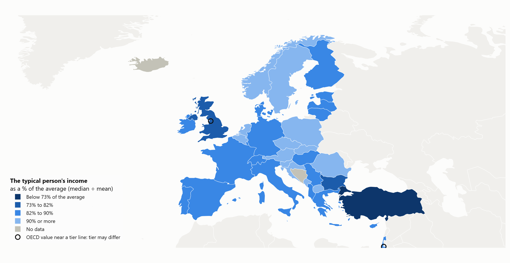

# typical-vs-average-income

How far is the typical person from the average? The median household income
as a share of the mean, across European and OECD countries.

*Work in progress: the headline map is built (`site/index.html`), not deployed yet.*



*Latest value per country, in tiers. World view: [images/map_latest.png](images/map_latest.png).
OECD values (non-European countries, and the UK's latest value) are hatched only in the live
page; these static images show them unhatched. The open circles mark OECD values whose tier
may differ under Eurostat's method.*

## The question

The average (mean) income is pulled up by the highest incomes. The median is
the income of the person in the middle. The further the median falls below
the mean, the less the "average" describes how a typical person lives.

**Headline measure:** median ÷ mean equivalised disposable income. "The
typical person has X% of the average income." A value of 0.90 means the
person in the middle has 90% of the mean.

Secondary layers (Europe only, never the headline): median income in PPS,
severe material and social deprivation, at-risk-of-poverty rate, inability to
face an unexpected expense, and difficulty making ends meet.

## Data

All figures are official statistics.

| Source | Dataset | Used for |
|---|---|---|
| Eurostat (EU-SILC) | `ilc_di03` | Median/mean ratio and median income in PPS, 37 European countries |
| OECD Income Distribution Database | `DSD_WISE_IDD@DF_IDD` | Median/mean ratio for 10 non-European OECD members (the "OECD extension") |
| Eurostat (EU-SILC) | `ilc_mdsd11`, `ilc_li02`, `ilc_mdes04`, `ilc_mdes09` | Deprivation and poverty layers |

**Each country comes from one source for its whole series.** Eurostat and
OECD values are never spliced or averaged within a country. OECD fills in
only countries Eurostat does not cover, and every OECD value carries
`source = OECD` so the map can draw it differently.

The World Inequality Database (top 10% income share) was checked and left
out: it measures pre-tax national income with tax and national-accounts
adjustments, so it cannot sit on the same scale as survey data.

### Output files

`data/processed/layer_<name>.csv`, one row per country and year, income
years 2002 onward (the EU-SILC comparability window):

| Column | Meaning |
|---|---|
| `country` | ISO-3 code |
| `year` | EU-SILC survey year; OECD years shifted +1 to match. Used to line the sources up |
| `income_year` | the year the income was earned (Eurostat: survey year - 1; OECD: as published). Used for display |
| `value` | the measure |
| `source` | `Eurostat` or `OECD` |
| `flag` | the source's flags (`break`, `provisional`, `estimated`, `low reliability`, ...) plus this project's own: `break_nso` (a break reported by the national statistics office but not flagged by Eurostat) and `unexplained_outlier`. Empty = no flag |
| `unit` | what `value` is measured in |

Layers: `median_mean_ratio` (headline), `median_income_pps`,
`severe_deprivation`, `at_risk_of_poverty`, `unexpected_expenses`,
`making_ends_meet`.

`data/processed/snapshot_median_mean_ratio.csv`: each country's latest
headline value, with a `note` column for the map. Tiers: below 0.73,
0.73-0.82, 0.82-0.90, 0.90 and above (`decisions.TIER_BOUNDARIES`, placed in
the widest gaps between countries). `tier_uncertain` is true for
OECD-sourced countries within 0.03 of a boundary (currently Mexico, the
USA, the UK, Israel, South Korea and Canada): their tier may differ under
Eurostat's method. For countries whose
Eurostat series has ended, it shows the OECD value if that is newer
(currently the UK), otherwise the country is left out (Iceland, Kosovo).

## Data limitations

1. **Older Eurostat figures are left out.** Before EU-SILC (2003-2005
   depending on the country, 2006 for Türkiye), Eurostat's series come from
   an earlier survey (ECHP) or national surveys. They are not comparable and
   are dropped, not spliced on.
2. **Eurostat and OECD income levels cannot be mixed.** For the same country
   and year the OECD median is 5-35% higher than Eurostat's. The OECD divides
   household income by the square root of household size; Eurostat uses the
   "modified OECD" scale. Only the ratio (which has no unit) is used from the
   OECD, and only for countries Eurostat does not cover.
3. **Year labels differ by one.** Eurostat labels by survey year, the OECD by
   income year. OECD years are shifted +1. Checked: the shifted pairs match
   better (mean absolute difference 0.009) than unshifted ones (0.013).
4. **The ratio depends somewhat on the source.** Where both sources cover a
   country (433 country-years, 27 countries), the OECD ratio is within 0.01
   of Eurostat's in 71% of cases and within 0.03 in 95% (median difference
   0.006, largest 0.062). In rankings, a country moves 1 place at the median
   and up to 4 places in 9 cases out of 10. The Netherlands, the UK and
   Sweden differ systematically (OECD 0.02-0.04 lower), so OECD-extension
   values should be read as ±0.03 against the Eurostat countries.
   Details: `data/processed/checks/ratio_eurostat_vs_oecd*.csv`.
5. **The spread is narrow.** In the latest-year snapshot, 37 of 45
   countries sit between 0.83 and 0.94, and 25 of them within 0.836-0.890. Small differences (0.01-0.02) move countries several
   ranks, so close neighbours should not be read as clearly different.
6. **Deprivation layers are Europe only.** The OECD's "difficulty making
   ends meet" is the same EU-SILC figure republished; outside Europe it
   covers only Canada, Mexico and New Zealand for a few years.
7. **Severe material and social deprivation starts in 2015** (the EU 2030
   definition, 13 items); 2017 for Türkiye. The older "material deprivation"
   series is a different indicator and is not joined on.
8. **Coverage gaps.** No data for Bosnia and Herzegovina, Liechtenstein or
   Colombia. Kosovo: 2018 only. Eurostat stops in 2018 for the UK and in
   2020 for Iceland; their series are not topped up from the OECD. In the
   latest-year snapshot only, the UK shows the OECD value for income year
   2023, hatched. Where both sources cover the UK (survey years 2005-2018),
   the OECD ratio is 0.039 lower on average (range 0.011 to 0.061 lower),
   so the UK's snapshot value is probably understated. Iceland (the OECD
   has nothing newer) and Kosovo are grey in the snapshot. The
   OECD extension is thin for Israel (1 year on the current definition),
   Japan (2), Australia, Mexico and Chile (every 2-3 years).
9. **Breaks in series.** Many countries have a flagged break (e.g. Germany
   2020, France 2020 and 2022, Luxembourg in 4 of the last 6 years). Flags
   are kept in the `flag` column. Türkiye's statistics office dates its last
   break to 2014, but Eurostat's data carries no flag there; the
   making-ends-meet layer marks Türkiye 2014 `break_nso` (see 10).
10. **Series checked before publishing** (not altered):
    - **Slovakia** (ratio 0.94-0.99): plausible. Slovakia has the EU's lowest
      Gini (about 21-24), and the OECD gives 0.95-0.97 independently. The
      2023 value (0.990) is a one-year spike seen only in Eurostat (OECD:
      0.957) and is unexplained; it is flagged `unexplained_outlier`.
      2025 has a flagged break.
    - **North Macedonia** (0.85 in 2014 to 0.95 in 2024): the rise is gradual
      and matches a steady fall in the Gini (35.2 to 29.2), so it is
      consistent within Eurostat's data. No independent source covers it;
      the cause of the trend and of the 2021 break are not documented in
      anything found.
    - **Türkiye, making ends meet with difficulty** (56% in 2013, 16% in
      2017, 34% in 2022, no Eurostat break flag): partly explained.
      TurkStat's quality report says its comparable series starts in 2014,
      which matches a step down in 2013-2014 (also seen in "cannot face
      an unexpected expense", 49% to 29%). The 2017-2018 low point is not
      explained: the share answering "fairly easily" jumped from 20% to 42%
      in one year and then fell back, while the poverty rate barely moved.
      Flagged as unexplained.
11. **Currency changes.** The OECD reports Bulgaria in euro. Irrelevant for
    the ratio, but national-currency levels should not be compared over the
    switch.
12. **Small differences in income period.** Ireland and the UK measure income
    over a recent 12-month period rather than the previous calendar year.

Full source checks: [DATA_NOTES.md](DATA_NOTES.md).

## Map notes

### Why mixing income years in the Latest view is acceptable

The Latest view shows each country's most recent value, so income years range
from 2020 to 2025 (most are 2023-2024). A country's ratio moves slowly. In
Eurostat's yearly data, the change between two years k apart, over all
countries and years:

| Years apart | Median change | 90th percentile |
|---|---|---|
| 1 | 0.008 | 0.025 |
| 2 | 0.010 | 0.031 |
| 3 | 0.011 | 0.034 |
| 4 | 0.012 | 0.039 |

A value one year older than most typically differs by less than 0.01. Even at
four years old, 9 in 10 values have moved less than 0.04, about the same as
the difference between Eurostat and OECD (±0.03). So an older value can only
change the picture for a country close to a tier line. The five countries
with data from income year 2022 or earlier have a dashed outline. **Caveat:**
of these, Mexico (income year 2022, 0.757) is only 0.027 above the 0.73
line, less than the 90th-percentile two-year change (0.030), so its tier
could be different with current data. The other four (Australia, Japan,
Chile, New Zealand) are further from a line than 9 in 10 changes of their
data's age, though Australia and New Zealand only just.
(`src/probes/probe_year_mixing.py`.)

### Base map resolution

The map uses Natural Earth's 1:50m outlines (`RESOLUTION = 50` in
`src/build_map.py`), not the lighter 1:110m. At 1:110m Malta's shape is
empty, so Malta would disappear from the map despite having data. 1:110m
would be about 3.7 times faster (Edge, Europe view: a zoom/pan redraw takes
19 ms instead of 72 ms, a year change 53 ms instead of about 150 ms), and its
coastlines turn blocky when zoomed in. Details: DATA_NOTES.md, M1.

## Reproduce

Requires [uv](https://docs.astral.sh/uv/) and Python 3.13 (or
`pip install -r requirements.txt`).

```bash
uv sync
uv run python src/load_eurostat.py     # EU-SILC layers + eurostat_ratio.csv
uv run python src/load_oecd.py         # OECD ratio, all OECD countries
uv run python src/build_headline.py    # -> layer_median_mean_ratio.csv
uv run python src/check_robustness.py  # Eurostat vs OECD comparison
uv run python src/build_snapshot.py    # -> snapshot_median_mean_ratio.csv
uv run python src/report_coverage.py   # countries and years per layer
uv run python src/build_map.py         # -> site/index.html, images/*.png
```

The probes used to check the sources are in [src/probes/](src/probes/).

Processed data is committed (`data/processed/`); raw downloads are not.
